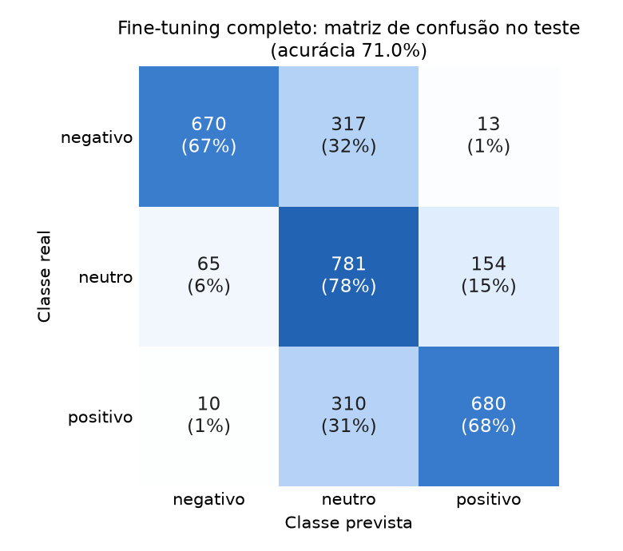
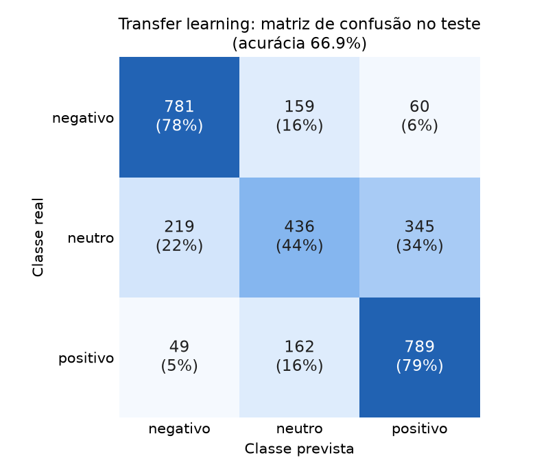

# aula09-cust-llm: sentimento de reviews com Qwen2.5-0.5B

Dá para transformar um LLM de meio bilhão de parâmetros num classificador de avaliações de produto? Peguei o
**Qwen2.5-0.5B**, arranquei a camada que gera texto e coloquei no lugar uma camada com só **3 saídas**:
`negativo`, `neutro` e `positivo`.

> **Em uma linha:** treinando o modelo inteiro cheguei a **71,0%** de acurácia no teste; treinando só a camada nova,
> **66,9%**, em 1/5 do tempo.

Está tudo em [`sentimento_trocando_lm_head.ipynb`](sentimento_trocando_lm_head.ipynb).

## A troca

```
texto ─► Qwen2.5 (24 blocos) ─► vetor do último token (896)
                                   ├─► lm_head   896 → 151.936   ✗ removido
                                   └─► score     896 → 3         ✓ novo, treinado do zero
```

O `lm_head` dá uma nota para cada token do vocabulário e serve para escolher a próxima palavra. Para classificar isso é
desperdício, então o `AutoModelForSequenceClassification(num_labels=3)` descarta essa camada e cria a `score`, que tem
só 2.688 pesos.

Uma coisa que me surpreendeu: o total de parâmetros quase não muda (494.032.768 → 494.035.456). É que no Qwen o
`lm_head` reaproveita a matriz de embeddings (*weight tying*), então tirá-lo não remove pesos.

## Dados

Avaliações reais de clientes da Americanas: [`ruanchaves/b2w-reviews01`](https://huggingface.co/datasets/ruanchaves/b2w-reviews01).

- nota 1–2 → negativo · nota 3 → neutro · nota 4–5 → positivo
- tirei os textos vazios e os repetidos, sobraram 126.724 avaliações
- amostra balanceada (seed 42): **6.000 por classe no treino**, 500 na validação e 1.000 no teste

O dataset vem com um script de carregamento que o `datasets` novo não roda mais, então carreguei a versão Parquet que o
próprio Hugging Face gera (`revision="refs/convert/parquet"`).

## Os dois treinos

Os dois usam batch 8, até 128 tokens e 3 épocas.

- **A, modelo inteiro:** todos os pesos são atualizados. AdamW com lr 2e-5, igual à aula.
- **B, só a `score`:** o Transformer fica congelado. Aqui usei lr 3e-4, porque com 1e-3 a loss de validação ficou pulando.

## Números (teste, 3.000 avaliações)

|  | A: tudo | B: só `score` |
|:--|--:|--:|
| Acurácia | **71,0%** | 66,9% |
| F1 macro | **0,718** | 0,659 |
| F1 do neutro | **0,649** | 0,496 |
| Pesos treinados | 494 milhões | 2.688 |
| Tempo de treino | 26,9 min | **5,0 min** |
| Memória de GPU | 4,7 GB | **1,1 GB** |

Rodei numa RTX 3000 Ada Laptop (8 GB). No meio do treino A o laptop baixou o limite de energia da GPU, então esse tempo
ficou um pouco inflado.

<p align="center">
  
  
</p>

## O que eu tirei disso

1. **Funciona.** Só trocando a cabeça, o LLM já fica bem acima do chute (33%).
2. **Treinar tudo ganha, mas a vantagem está quase toda no neutro.** Em negativo e positivo os dois treinos praticamente empatam.
3. **O treino A decorou o treino.** A acurácia de validação foi 76,1% na 1ª época e caiu para 71,8% na 3ª. Uma época só teria sido melhor.
4. **O treino B é barato** e ainda estava melhorando quando parou.
5. **Neutro é difícil por natureza.** Nota 3 costuma vir com "bonito, mas…", e às vezes a nota nem combina com o texto.

Algumas frases que eu mesmo escrevi:

| Frase | A | B |
|:--|:--|:--|
| "É ok. Cumpre o que promete, mas não tem nada de especial." | neutro (0,92) | negativo (0,48) |
| "A entrega atrasou uma semana, mas o produto em si é bom." | neutro (0,92) | neutro (0,50) |
| "Paguei caro e veio com defeito. Não comprem." | negativo (0,94) | negativo (0,98) |

As 8 frases completas estão no fim do notebook.

## Rodar

```bash
uv venv --python 3.12 .venv
uv pip install --python .venv/bin/python -r requirements.txt
.venv/bin/jupyter lab sentimento_trocando_lm_head.ipynb
```

No Colab: escolha um ambiente com GPU, descomente o `pip install` da primeira célula e rode tudo. Na T4 o notebook muda
para float32 sozinho; se ficar lento, diminua `N_TREINO_POR_CLASSE`.

## Arquivos

- `sentimento_trocando_lm_head.ipynb`: código e saídas
- `resultados/`: matrizes de confusão, `comparacao.csv` e `metricas.json`
- `requirements.txt`: as versões que eu usei

---

<sub>Feito para a Aula 09 ("Ajustando um LLM") de IA Generativa na UFPR, com o prof. Paulo Lisboa de Almeida.</sub>
